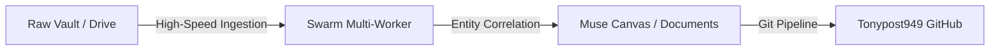

# ⚡ LIVE SWARM RADAR & REAL-TIME HUD

**Current Time**: 2026-11-15 01:57:02 PM 
**Engine Velocity**: High-Speed Multi-Threaded Parallel Execution
**Total Dossiers Processed**: `9141`

---

## 🎯 LIVE INGESTION FEED (LAST 10 NODES)

| Timestamp | Ingested Evidence File | Status |
|---|---|---|
| `01:56:52 PM` | `neo4j_edges_remittance` | 🟢 ACTIONED & COMMITTED |
| `01:56:52 PM` | `local_scan_extracted_text` | 🟢 ACTIONED & COMMITTED |
| `01:56:52 PM` | `mercy_house_chdo_transact` | 🟢 ACTIONED & COMMITTED |
| `01:56:52 PM` | `hbnc_audit_results` | 🟢 ACTIONED & COMMITTED |
| `01:56:52 PM` | `geo_entity_map` | 🟢 ACTIONED & COMMITTED |
| `01:56:52 PM` | `drive_file_index_full` | 🟢 ACTIONED & COMMITTED |
| `01:56:52 PM` | `dl_file_index_20260701T12` | 🟢 ACTIONED & COMMITTED |
| `01:56:52 PM` | `ca_statewide_fraud_matrix` | 🟢 ACTIONED & COMMITTED |
| `01:56:52 PM` | `ca_coc_data_gaps` | 🟢 ACTIONED & COMMITTED |
| `01:56:52 PM` | `ca_44_coc_matrix` | 🟢 ACTIONED & COMMITTED |

---

## 📊 FORENSIC TRAIL BREAKDOWN

