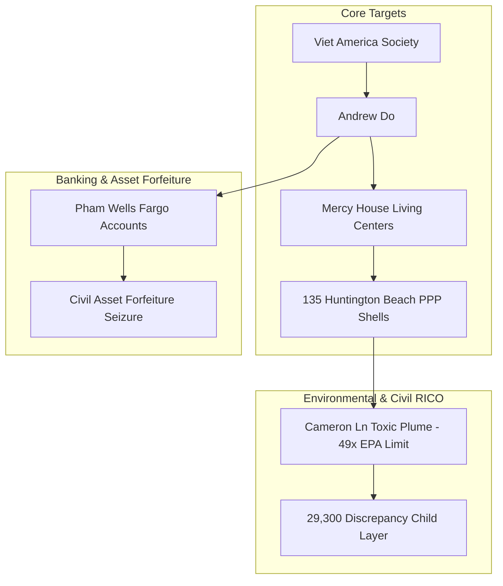

# 🌐 MUSE INTERACTIVE WAR ROOM & TARGET MATRIX
**Commander**: `ironmandavinci@gmail.com`
**Live Stream Updated**: 2026-11-15 01:16:30
**Active Ingested Dossiers**: 612

---

## 📊 LIVE INTELLIGENCE FEED

| Timestamp | Dossier Target | Status | Link |
|---|---|---|---|
| 01:16:19 | `20261115_011619_AI_SYSTEMS_MASTER_EXTRACT` | 🟢 INGESTED & AUDITED | [View File](./20261115_011619_RESOLVED_AI_SYSTEMS_MASTER_EXTRACT.md) |
| 01:16:04 | `20261115_011604_AI_INSTRUCTIONS` | 🟢 INGESTED & AUDITED | [View File](./20261115_011604_RESOLVED_AI_INSTRUCTIONS.md) |
| 01:15:49 | `20261115_011549_AGENTS` | 🟢 INGESTED & AUDITED | [View File](./20261115_011549_RESOLVED_AGENTS.md) |
| 01:15:34 | `20261115_011534_15_SWIFT_LLC_OWNERSHIP_FI` | 🟢 INGESTED & AUDITED | [View File](./20261115_011534_RESOLVED_15_SWIFT_LLC_OWNERSHIP_FI.md) |
| 01:15:19 | `20261115_011519_README` | 🟢 INGESTED & AUDITED | [View File](./20261115_011519_RESOLVED_README.md) |
| 01:14:04 | `20261115_011404_MEXICO_EVIDENTIARY_STANDA` | 🟢 INGESTED & AUDITED | [View File](./20261115_011404_RESOLVED_MEXICO_EVIDENTIARY_STANDA.md) |
| 01:13:48 | `20261115_011348_RICO_NATIONWIDE_INFRASTRU` | 🟢 INGESTED & AUDITED | [View File](./20261115_011348_RESOLVED_RICO_NATIONWIDE_INFRASTRU.md) |
| 01:13:33 | `20261115_011333_EVIDENCE_INDEX` | 🟢 INGESTED & AUDITED | [View File](./20261115_011333_RESOLVED_EVIDENCE_INDEX.md) |
| 01:13:18 | `20261115_011318_RICO_AND_MUNICIPAL_FRAUD_` | 🟢 INGESTED & AUDITED | [View File](./20261115_011318_RESOLVED_RICO_AND_MUNICIPAL_FRAUD_.md) |
| 01:13:03 | `20261115_011303_opencode_share_clean` | 🟢 INGESTED & AUDITED | [View File](./20261115_011303_RESOLVED_opencode_share_clean.md) |
| 01:12:48 | `20261115_011248_makaveli_system_prompt` | 🟢 INGESTED & AUDITED | [View File](./20261115_011248_RESOLVED_makaveli_system_prompt.md) |
| 01:12:33 | `20261115_011233_gemini_session_osint_neoa` | 🟢 INGESTED & AUDITED | [View File](./20261115_011233_RESOLVED_gemini_session_osint_neoa.md) |
| 01:12:18 | `20261115_011218_dossiers_in_bigquery` | 🟢 INGESTED & AUDITED | [View File](./20261115_011218_RESOLVED_dossiers_in_bigquery.md) |
| 01:12:03 | `20261115_011203_chokepoint_extraction_rep` | 🟢 INGESTED & AUDITED | [View File](./20261115_011203_RESOLVED_chokepoint_extraction_rep.md) |
| 01:11:48 | `20261115_011148_bookmarks_investigation_f` | 🟢 INGESTED & AUDITED | [View File](./20261115_011148_RESOLVED_bookmarks_investigation_f.md) |
| 01:11:33 | `20261115_011133_TASKLET_THREAD_s9trnktyg0` | 🟢 INGESTED & AUDITED | [View File](./20261115_011133_RESOLVED_TASKLET_THREAD_s9trnktyg0.md) |
| 01:11:18 | `20261115_011118_TASKLET_AI_MASTER_EXTRACT` | 🟢 INGESTED & AUDITED | [View File](./20261115_011118_RESOLVED_TASKLET_AI_MASTER_EXTRACT.md) |
| 01:11:03 | `20261115_011103_TASKLET_AGENT_WORKSPACE_C` | 🟢 INGESTED & AUDITED | [View File](./20261115_011103_RESOLVED_TASKLET_AGENT_WORKSPACE_C.md) |
| 01:10:48 | `20261115_011048_REPO_MASTER_INDEX` | 🟢 INGESTED & AUDITED | [View File](./20261115_011048_RESOLVED_REPO_MASTER_INDEX.md) |
| 01:10:33 | `20261115_011033_RED_HANDED_SUMMARY` | 🟢 INGESTED & AUDITED | [View File](./20261115_011033_RESOLVED_RED_HANDED_SUMMARY.md) |

---

## 🎯 FORENSIC CORRELATION & RICO MAP

