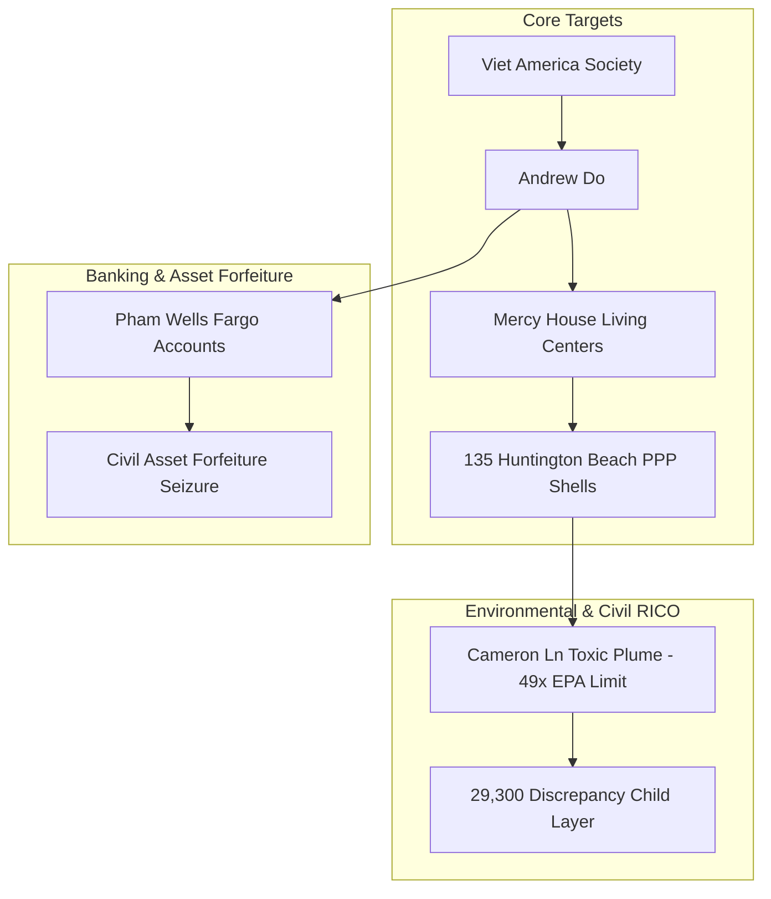

# 🌐 MUSE INTERACTIVE WAR ROOM & TARGET MATRIX
**Commander**: `ironmandavinci@gmail.com`
**Live Stream Updated**: 2026-11-15 10:48:10
**Active Ingested Dossiers**: 2007

---

## 📊 LIVE INTELLIGENCE FEED

| Timestamp | Dossier Target | Status | Link |
|---|---|---|---|
| 10:48:05 | `20261115_104805_RICO_AND_MUNICIPAL_FRAUD_` | 🟢 INGESTED & AUDITED | [View File](./20261115_104805_RESOLVED_RICO_AND_MUNICIPAL_FRAUD_.md) |
| 10:47:50 | `20261115_104750_opencode_share_clean` | 🟢 INGESTED & AUDITED | [View File](./20261115_104750_RESOLVED_opencode_share_clean.md) |
| 10:47:35 | `20261115_104735_makaveli_system_prompt` | 🟢 INGESTED & AUDITED | [View File](./20261115_104735_RESOLVED_makaveli_system_prompt.md) |
| 10:47:20 | `20261115_104720_gemini_session_osint_neoa` | 🟢 INGESTED & AUDITED | [View File](./20261115_104720_RESOLVED_gemini_session_osint_neoa.md) |
| 10:47:05 | `20261115_104705_dossiers_in_bigquery` | 🟢 INGESTED & AUDITED | [View File](./20261115_104705_RESOLVED_dossiers_in_bigquery.md) |
| 10:46:50 | `20261115_104650_chokepoint_extraction_rep` | 🟢 INGESTED & AUDITED | [View File](./20261115_104650_RESOLVED_chokepoint_extraction_rep.md) |
| 10:46:35 | `20261115_104635_bookmarks_investigation_f` | 🟢 INGESTED & AUDITED | [View File](./20261115_104635_RESOLVED_bookmarks_investigation_f.md) |
| 10:46:20 | `20261115_104620_TASKLET_THREAD_s9trnktyg0` | 🟢 INGESTED & AUDITED | [View File](./20261115_104620_RESOLVED_TASKLET_THREAD_s9trnktyg0.md) |
| 10:46:05 | `20261115_104605_TASKLET_AI_MASTER_EXTRACT` | 🟢 INGESTED & AUDITED | [View File](./20261115_104605_RESOLVED_TASKLET_AI_MASTER_EXTRACT.md) |
| 10:45:50 | `20261115_104549_TASKLET_AGENT_WORKSPACE_C` | 🟢 INGESTED & AUDITED | [View File](./20261115_104549_RESOLVED_TASKLET_AGENT_WORKSPACE_C.md) |
| 10:45:34 | `20261115_104534_REPO_MASTER_INDEX` | 🟢 INGESTED & AUDITED | [View File](./20261115_104534_RESOLVED_REPO_MASTER_INDEX.md) |
| 10:45:19 | `20261115_104519_RED_HANDED_SUMMARY` | 🟢 INGESTED & AUDITED | [View File](./20261115_104519_RESOLVED_RED_HANDED_SUMMARY.md) |
| 10:45:04 | `20261115_104504_PETRUCCIO_MEDICAL_SUMMARY` | 🟢 INGESTED & AUDITED | [View File](./20261115_104504_RESOLVED_PETRUCCIO_MEDICAL_SUMMARY.md) |
| 10:44:49 | `20261115_104449_OSINT_Civil_Rights_Integr` | 🟢 INGESTED & AUDITED | [View File](./20261115_104449_RESOLVED_OSINT_Civil_Rights_Integr.md) |
| 10:44:34 | `20261115_104434_OSINT_BIGQUERY_INGESTION_` | 🟢 INGESTED & AUDITED | [View File](./20261115_104434_RESOLVED_OSINT_BIGQUERY_INGESTION_.md) |
| 10:44:19 | `20261115_104419_OSINTNEOAI_AGENT_SETUP` | 🟢 INGESTED & AUDITED | [View File](./20261115_104419_RESOLVED_OSINTNEOAI_AGENT_SETUP.md) |
| 10:44:04 | `20261115_104404_OPENCODE_FORENSIC_MASTER_` | 🟢 INGESTED & AUDITED | [View File](./20261115_104404_RESOLVED_OPENCODE_FORENSIC_MASTER_.md) |
| 10:43:49 | `20261115_104349_NUWEYT_HBNC_ADDRESS_MANIP` | 🟢 INGESTED & AUDITED | [View File](./20261115_104349_RESOLVED_NUWEYT_HBNC_ADDRESS_MANIP.md) |
| 10:43:34 | `20261115_104334_MEXICO_CROSS_BORDER_INDEP` | 🟢 INGESTED & AUDITED | [View File](./20261115_104334_RESOLVED_MEXICO_CROSS_BORDER_INDEP.md) |
| 10:43:19 | `20261115_104319_LIGHTBOX_RE_INTEGRATION_G` | 🟢 INGESTED & AUDITED | [View File](./20261115_104319_RESOLVED_LIGHTBOX_RE_INTEGRATION_G.md) |

---

## 🎯 FORENSIC CORRELATION & RICO MAP

