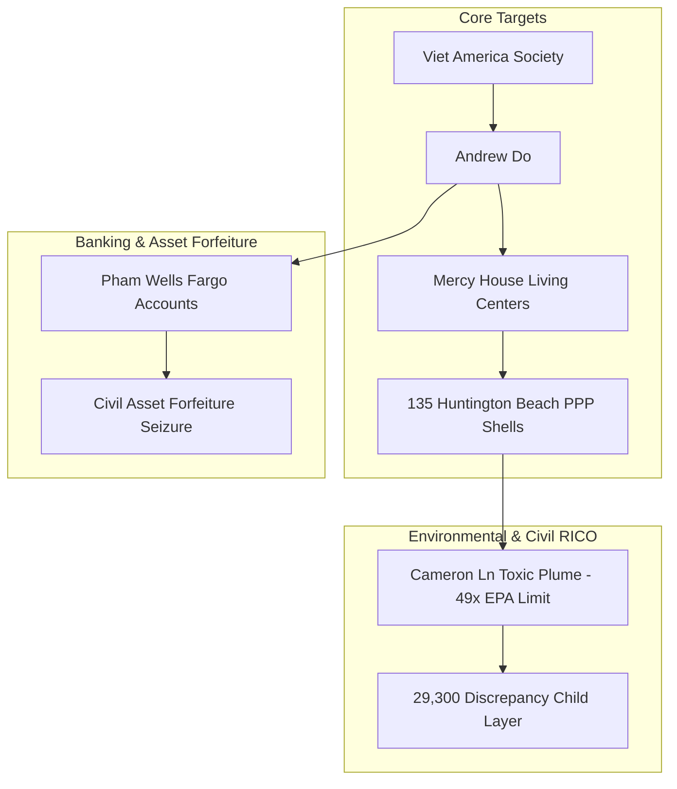

# 🌐 MUSE INTERACTIVE WAR ROOM & TARGET MATRIX
**Commander**: `ironmandavinci@gmail.com`
**Live Stream Updated**: 2026-11-15 03:40:55
**Active Ingested Dossiers**: 1148

---

## 📊 LIVE INTELLIGENCE FEED

| Timestamp | Dossier Target | Status | Link |
|---|---|---|---|
| 03:40:50 | `20261115_034050_bookmarks_investigation_f` | 🟢 INGESTED & AUDITED | [View File](./20261115_034050_RESOLVED_bookmarks_investigation_f.md) |
| 03:40:35 | `20261115_034035_TASKLET_THREAD_s9trnktyg0` | 🟢 INGESTED & AUDITED | [View File](./20261115_034035_RESOLVED_TASKLET_THREAD_s9trnktyg0.md) |
| 03:40:20 | `20261115_034020_TASKLET_AI_MASTER_EXTRACT` | 🟢 INGESTED & AUDITED | [View File](./20261115_034020_RESOLVED_TASKLET_AI_MASTER_EXTRACT.md) |
| 03:40:05 | `20261115_034005_TASKLET_AGENT_WORKSPACE_C` | 🟢 INGESTED & AUDITED | [View File](./20261115_034005_RESOLVED_TASKLET_AGENT_WORKSPACE_C.md) |
| 03:39:50 | `20261115_033950_REPO_MASTER_INDEX` | 🟢 INGESTED & AUDITED | [View File](./20261115_033950_RESOLVED_REPO_MASTER_INDEX.md) |
| 03:39:35 | `20261115_033935_RED_HANDED_SUMMARY` | 🟢 INGESTED & AUDITED | [View File](./20261115_033935_RESOLVED_RED_HANDED_SUMMARY.md) |
| 03:39:20 | `20261115_033920_PETRUCCIO_MEDICAL_SUMMARY` | 🟢 INGESTED & AUDITED | [View File](./20261115_033920_RESOLVED_PETRUCCIO_MEDICAL_SUMMARY.md) |
| 03:39:05 | `20261115_033905_OSINT_Civil_Rights_Integr` | 🟢 INGESTED & AUDITED | [View File](./20261115_033905_RESOLVED_OSINT_Civil_Rights_Integr.md) |
| 03:38:50 | `20261115_033850_OSINT_BIGQUERY_INGESTION_` | 🟢 INGESTED & AUDITED | [View File](./20261115_033850_RESOLVED_OSINT_BIGQUERY_INGESTION_.md) |
| 03:38:35 | `20261115_033835_OSINTNEOAI_AGENT_SETUP` | 🟢 INGESTED & AUDITED | [View File](./20261115_033835_RESOLVED_OSINTNEOAI_AGENT_SETUP.md) |
| 03:38:20 | `20261115_033820_OPENCODE_FORENSIC_MASTER_` | 🟢 INGESTED & AUDITED | [View File](./20261115_033820_RESOLVED_OPENCODE_FORENSIC_MASTER_.md) |
| 03:38:05 | `20261115_033804_NUWEYT_HBNC_ADDRESS_MANIP` | 🟢 INGESTED & AUDITED | [View File](./20261115_033804_RESOLVED_NUWEYT_HBNC_ADDRESS_MANIP.md) |
| 03:37:49 | `20261115_033749_MEXICO_CROSS_BORDER_INDEP` | 🟢 INGESTED & AUDITED | [View File](./20261115_033749_RESOLVED_MEXICO_CROSS_BORDER_INDEP.md) |
| 03:37:34 | `20261115_033734_LIGHTBOX_RE_INTEGRATION_G` | 🟢 INGESTED & AUDITED | [View File](./20261115_033734_RESOLVED_LIGHTBOX_RE_INTEGRATION_G.md) |
| 03:37:19 | `20261115_033719_HBPD_PORT_SCAN_REPORT` | 🟢 INGESTED & AUDITED | [View File](./20261115_033719_RESOLVED_HBPD_PORT_SCAN_REPORT.md) |
| 03:37:04 | `20261115_033704_Gemini_Gem_Antigravity` | 🟢 INGESTED & AUDITED | [View File](./20261115_033704_RESOLVED_Gemini_Gem_Antigravity.md) |
| 03:36:49 | `20261115_033649_GMAIL_OUTREACH_TIMELINE` | 🟢 INGESTED & AUDITED | [View File](./20261115_033649_RESOLVED_GMAIL_OUTREACH_TIMELINE.md) |
| 03:36:34 | `20261115_033634_GIT_HISTORY_CLEANUP_NOTES` | 🟢 INGESTED & AUDITED | [View File](./20261115_033634_RESOLVED_GIT_HISTORY_CLEANUP_NOTES.md) |
| 03:36:19 | `20261115_033619_GITHUB_MASTER_EXTRACTION_` | 🟢 INGESTED & AUDITED | [View File](./20261115_033619_RESOLVED_GITHUB_MASTER_EXTRACTION_.md) |
| 03:36:04 | `20261115_033604_GEMINI_NEW_INTEL_EXTRACT` | 🟢 INGESTED & AUDITED | [View File](./20261115_033604_RESOLVED_GEMINI_NEW_INTEL_EXTRACT.md) |

---

## 🎯 FORENSIC CORRELATION & RICO MAP

