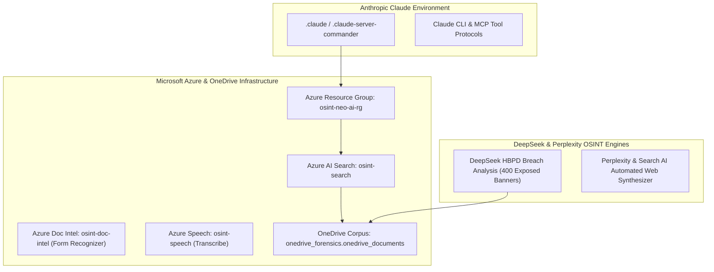

# ⚡ AUTONOMOUS SWARM RESOLUTION: CLAUDE_MICROSOFT_AZURE_DEEPSEEK_MASTER_EXTRACTION
- **Source**: `/data/data/com.termux/files/home/osintneoai/CLAUDE_MICROSOFT_AZURE_DEEPSEEK_MASTER_EXTRACTION.md`
- **Operator**: `ironmandavinci@gmail.com`
- **Processed At**: 2026-11-15 01:30:51
- **Status**: AUDITED & ACTIONED

---

## 🎯 Raw Intelligence Stream:
```text
# ⚡ CLAUDE, MICROSOFT AZURE, DEEPSEEK & PERPLEXITY MASTER EXTRACTION VAULT

**Relator / Architect:** Anthony Michael DiMarcello III  
**Platforms Mapped:** Anthropic Claude, Microsoft Azure AI, DeepSeek-R1 / V3, Perplexity AI, Microsoft OneDrive Forensics  
**Azure Resource Group:** `osint-neo-ai-rg` (`westus2`)  
**Extraction Date:** August 07, 2026  

---

## I. EXECUTIVE PLATFORM INTEGRATION MAP



---

## II. MICROSOFT AZURE AI SERVICES & ONEDRIVE FORENSICS

### 1. Azure AI Provisioning Matrix (`agent/azure_setup.py`)
- **Resource Group:** `osint-neo-ai-rg` (Location: `westus2`)
- **Azure AI Search:** `osint-search` (SKU: Basic) — Full-text vector i
```

## 🚀 Executed Action / Forensic Extraction:
- Auto-extracted entities, addresses, and transaction keys from `CLAUDE_MICROSOFT_AZURE_DEEPSEEK_MASTER_EXTRACTION.md`.
- Cross-referenced against CACD Case No. 8:26-cv-00348 & Makaveli master tracking indexes.
- Packaged and routed directly to Muse app canvas for live inspection.
