# ⚡ AUTONOMOUS SWARM RESOLUTION: RICO_NATIONWIDE_INFRASTRUCTURE_MATRIX
- **Source**: `/data/data/com.termux/files/home/osintneoai/RICO_NATIONWIDE_INFRASTRUCTURE_MATRIX.md`
- **Operator**: `ironmandavinci@gmail.com`
- **Processed At**: 2026-11-15 03:15:45
- **Status**: AUDITED & ACTIONED

---

## 🎯 Raw Intelligence Stream:
```text
# RICO NATIONWIDE INFRASTRUCTURE MATRIX

## Infrastructure Topology Diagram

```mermaid
graph TD
    subgraph Subnet_141_193_213 [Subnet Block: 141.193.213.0/24 - Host .21]
        A[libertyseniorliving.com]
        B["l2tmedia.com (RICO Shell)"]
        C["cookcountysheriff.org (Gov / Law Enforcement)"]
    end

    subgraph Host_3_33_130_190 [Single IP Host: 3.33.130.190]
        D[atlanticpacificcommunities.com]
        E[carlisledev.com]
        F["illuminationfoundation.org ($2M PPP Fraud)"]
    end

    subgraph Host_76_223_54_146 [Single IP Host: 76.223.54.146]
        G[libertyhomes.org]
        H[libertycare.com]
        I[libertycare.org]
        J["rbabuilders.com ($2.59M PPP Fraud)"]
    end

    subgraph Subnet_206_188_193 [Subnet Block: 206.188.193.0/24]
        K["stewartindustries.com (.48)"]
        L["cararlisledevelopment.com (.178)"]
    end

    subgraph Host_188_214_128_77 [Single IP Host: 188.214.128.77 - NO WAF]
        M2[cityofhuntingtonbeach.com]
        N2[cityoftustin.org]
    end

    subgraph Nuway_RealEstate_Cluster [Nuway / Newey Real Estate & Shell Network]
        P1["raipartners.com ($2.8M Property Shuffle)"]
        P2["starpointproperties.com (Subnet .10)"]
        P3["cmcleaning.com ($916K PPP Fraud)"]
    end

    A --- B
    B --- C
    D --- E
    E --- F
    G --- J
    H --- J
    I --- J
    K --- L
    M2 --- N2
    P1 --- P2
```



## Infrastructure Matrix Table

| CIDR / IP Address | Primary Domains | Shared / Co-located Infrastru
```

## 🚀 Executed Action / Forensic Extraction:
- Auto-extracted entities, addresses, and transaction keys from `RICO_NATIONWIDE_INFRASTRUCTURE_MATRIX.md`.
- Cross-referenced against CACD Case No. 8:26-cv-00348 & Makaveli master tracking indexes.
- Packaged and routed directly to Muse app canvas for live inspection.
