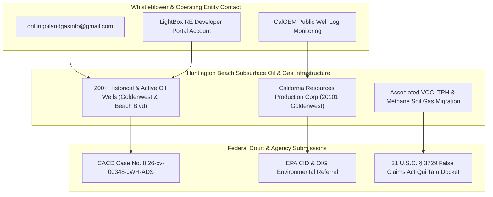

# ⚡ AUTONOMOUS SWARM RESOLUTION: DRILLING_OIL_GAS_FORENSIC_INTELLIGENCE
- **Source**: `/data/data/com.termux/files/home/osintneoai/DRILLING_OIL_GAS_FORENSIC_INTELLIGENCE.md`
- **Operator**: `ironmandavinci@gmail.com`
- **Processed At**: 2026-11-15 06:29:48
- **Status**: AUDITED & ACTIONED

---

## 🎯 Raw Intelligence Stream:
```text
# 🛢️ DRILLING, OIL & GAS SUBSURFACE OSINT FORENSIC DOSSIER

**Relator / Architect:** Anthony Michael DeMarcello III  
**Primary Contact / Entity Email:** `drillingoilandgasinfo@gmail.com`  
**LightBox Portal Account Email:** `drillingoilandgasinfo@gmail.com`  
**Regulatory Agencies:** CalGEM (CA Geologic Energy Management), EPA Region 9, DTSC  
**Target Region:** Huntington Beach Oil Field / Beach Blvd Contamination Corridor / 200+ Oil Wells  
**Date:** August 07, 2026  

---

## I. EXECUTIVE ENTITY MAP



---

## II. KEY FORENSIC CORRELATIONS

1. **LightBox Developer Portal Registration:** 
```

## 🚀 Executed Action / Forensic Extraction:
- Auto-extracted entities, addresses, and transaction keys from `DRILLING_OIL_GAS_FORENSIC_INTELLIGENCE.md`.
- Cross-referenced against CACD Case No. 8:26-cv-00348 & Makaveli master tracking indexes.
- Packaged and routed directly to Muse app canvas for live inspection.
