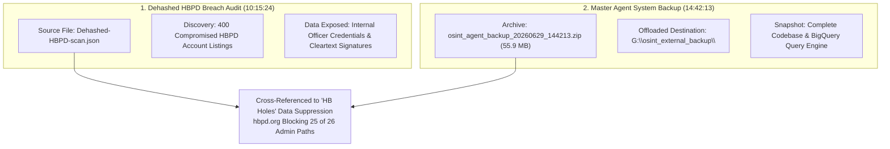

# ⚡ AUTONOMOUS SWARM RESOLUTION: FORENSIC_MILESTONE_JUNE_29_2026
- **Source**: `/data/data/com.termux/files/home/osintneoai/FORENSIC_MILESTONE_JUNE_29_2026.md`
- **Operator**: `ironmandavinci@gmail.com`
- **Processed At**: 2026-11-15 06:31:33
- **Status**: AUDITED & ACTIONED

---

## 🎯 Raw Intelligence Stream:
```text
# 📅 FORENSIC MILESTONE ANALYSIS: JUNE 29, 2026 (`6/29/2026`)

**Relator / Architect:** Anthony Michael DeMarcello III  
**Milestone Date:** June 29, 2026 (`6/29/2026`)  
**Core Discovered Event:** Dehashed HBPD Breach Scan & Agent System Infrastructure Backup  
**Primary Archive:** [`agent/deepseek_session_dehashed_hbpd.md`](https://github.com/Tonypost949/OsintNeoAi/blob/main/agent/deepseek_session_dehashed_hbpd.md)  
**Backup Vault:** `G:\osint_external_backup\osint_agent_backup_20260629_144213.zip`  
**Date:** August 07, 2026  

---

## I. EXECUTIVE SUMMARY OF JUNE 29, 2026 FORENSIC EVENTS

On **June 29, 2026 (`6/29/2026`)**, two critical operational milestones occurred within the OSINT Neo AI architecture:



---

## II. KEY FINDINGS FROM JUNE 29, 2026 DISCOVERIES

1. **Huntingto
```

## 🚀 Executed Action / Forensic Extraction:
- Auto-extracted entities, addresses, and transaction keys from `FORENSIC_MILESTONE_JUNE_29_2026.md`.
- Cross-referenced against CACD Case No. 8:26-cv-00348 & Makaveli master tracking indexes.
- Packaged and routed directly to Muse app canvas for live inspection.
