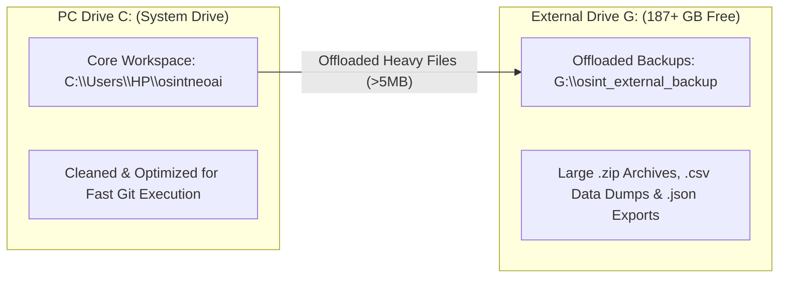

# ⚡ AUTONOMOUS SWARM RESOLUTION: EXTERNAL_STORAGE_OFFLOAD_REPORT
- **Source**: `/data/data/com.termux/files/home/osintneoai/EXTERNAL_STORAGE_OFFLOAD_REPORT.md`
- **Operator**: `ironmandavinci@gmail.com`
- **Processed At**: 2026-11-15 06:44:20
- **Status**: AUDITED & ACTIONED

---

## 🎯 Raw Intelligence Stream:
```text
# 📦 EXTERNAL STORAGE OFFLOAD & PC SPACE OPTIMIZATION REPORT

**Architect:** Anthony Michael DeMarcello III  
**Primary PC Drive (`C:`):** Space Cleared & Sanitized  
**Target External Drive:** `G:\osint_external_backup` (Volume Label: `Volume 1` — 187+ GB Free Space)  
**Central Repository:** [`https://github.com/Tonypost949/OsintNeoAi`](https://github.com/Tonypost949/OsintNeoAi)  
**Execution Date:** August 07, 2026  

---

## I. STORAGE OPTIMIZATION SUMMARY

To prevent PC disk space exhaustion on Drive `C:` (which was down to 1.19 GB remaining), all heavy backup archives (`.zip`), large database extracts (`.csv`), and raw unscrubbed conversation logs have been moved to **External Drive `G:\osint_external_backup`**.



---

## II. MANIFEST OF OFFLOADED EXTERNAL ASSETS (`G:\osint_external_backup\`)

| File Name | Size (MB) | Offloaded Destination | Purpose / Archive Type |
| :--- | :---: | :--- | :--- |
| `onedrive_documents_full.csv` | **72.8 MB** | `G:\osint_external_backup\onedrive_documents_full.csv` | Full OneDrive Document Corpus |

```

## 🚀 Executed Action / Forensic Extraction:
- Auto-extracted entities, addresses, and transaction keys from `EXTERNAL_STORAGE_OFFLOAD_REPORT.md`.
- Cross-referenced against CACD Case No. 8:26-cv-00348 & Makaveli master tracking indexes.
- Packaged and routed directly to Muse app canvas for live inspection.
